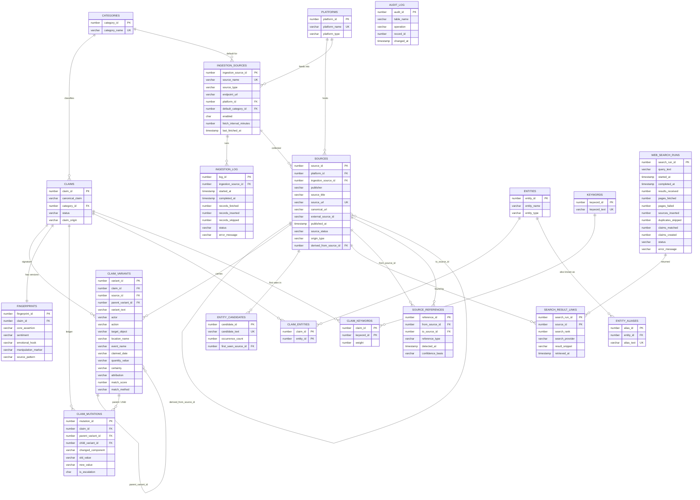

# ER diagram

The Database Lab page renders an interactive version of this diagram. Below is the same model in Mermaid syntax, which GitHub and many Markdown viewers render.

Relationship types shown:

- **One-to-many:** PLATFORMS → SOURCES, CLAIMS → CLAIM_VARIANTS, ENTITIES → ENTITY_ALIASES …
- **One-to-one:** CLAIMS → FINGERPRINTS (enforced by `UQ_FINGERPRINTS_CLAIM`)
- **Many-to-many:** CLAIMS ↔ ENTITIES (CLAIM_ENTITIES), CLAIMS ↔ KEYWORDS (CLAIM_KEYWORDS), WEB_SEARCH_RUNS ↔ SOURCES (SEARCH_RESULT_LINKS), SOURCES ↔ SOURCES (SOURCE_REFERENCES)
- **Self-referencing:** SOURCES.derived_from_source_id (source lineage), CLAIM_VARIANTS.parent_variant_id (claim lineage)
